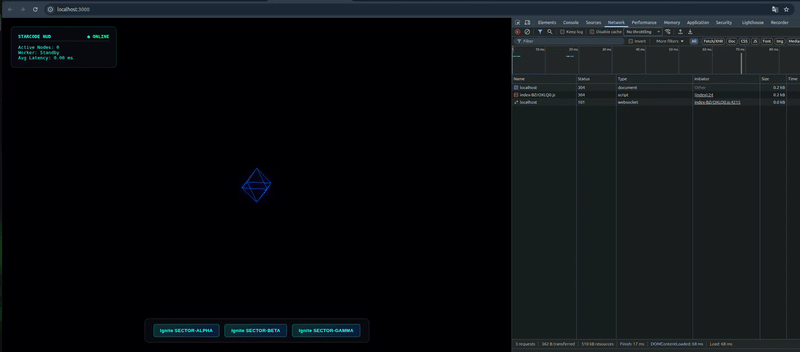

# 🌌 Starcode Cluster

A distributed polyglot gRPC microservice architecture orchestrating real-time spatial constellation data and streaming into an interactive 3D WebGL interface via Three.js.

[](https://github.com)
[](https://grpc.io/)
[](https://protobuf.dev/)
[-black?style=for-the-badge&logo=threedotjs)](https://threejs.org/)

[](https://python.org)
[](https://dotnet.microsoft.com/)
[](https://go.dev/)
[](https://nodejs.org/)
[](LICENSE)

---

## 🎬 Project Preview

<p align="center">
  
</p>

---

## 🚀 Overview & Architecture

**Starcode Cluster** showcases a high-throughput, polyglot backend where microservices written in **Python**, **.NET 8**, and **Go** compute spatial coordinates and stream node pulses over gRPC. A **Node.js WebSocket Gateway** bridges client events with these worker services, pushing real-time transformations directly into a **Three.js** canvas.

Igniting a specific sector routes matrix calculation requests to that language's dedicated worker. The incoming stream continuously morphs the core geometry, shifts ambient spectral lighting, and renders dynamic laser node rings.

### System Topology

```
       [ Frontend (Three.js UI + HUD) ]
                     │
         WebSocket (ws://localhost:8080)
                     ▼
  ┌─────────────────────────────────────┐
  │   Node.js WebSocket Gateway         │
  │   (Orchestrator & Router)           │
  └─────┬──────────────┬────────────┬───┘
        │              │            │
   gRPC │ (50051) gRPC │ (50052)    │ gRPC (50053)
        ▼              ▼            ▼
  ┌───────────┐  ┌───────────┐  ┌───────────┐
  │  Python   │  │   .NET 8  │  │    Go     │
  │  Worker   │  │   Worker  │  │   Worker  │
  └───────────┘  └───────────┘  └───────────┘
```

---

## 🔄 Data Flow & gRPC Stream Sequence

```
 [ Frontend / UI ]               [ Node.js Gateway ]             [ Selected Worker ]         [ Three.js Renderer ]
        │                                │                                │                                │
        │── 1. Ignite Sector Click ─────►│                                │                                │
        │                                │── 2. gRPC DecodeSector ───────►│                                │
        │                                │    (SectorRequest: ID, Nodes)  │                                │
        │                                │                                │── 3. Matrix Computation ───────┤
        │                                │                                │    (Angles, Radii, Edges)      │
        │                                │                                │                                │
        │                                │◄─ 4. gRPC Stream (SparkPulse) ─│                                │
        │                                │                                │                                │
        │── 5. WebSocket Broadcast ─────►│                                │                                │
        │                                │                                │── 6. UI / HUD Update ──────────┤
        │                                │                                │── 7. updateWorkerShape() ─────►│
        │                                │                                │    (Morph Core: Box/Octa/Ico)  │
        │                                │                                │── 8. Render Nodes & Lasers ───►│
```

---

## 📡 What is gRPC?

[gRPC (Remote Procedure Calls)](https://grpc.io/) is an open-source, high-performance RPC framework initially designed by Google. Unlike standard REST/JSON setups that incur overhead by parsing string text over HTTP/1.1, gRPC runs atop **HTTP/2** and packages payloads using **Protocol Buffers (Protobuf)**.

### Key Benefits:
- **Binary Serialization:** Protobuf serializes structured data into compact binary formats, drastically reducing network overhead.
- **Bi-directional & Server Streaming:** Allows workers to stream data packets (`SparkPulse`) continuously back to the gateway in real-time.
- **Polyglot Code Generation:** Enforces strict service contracts (`constellation.proto`), allowing seamless integration across Python, .NET, and Go.

### Resources:
- [Official gRPC Documentation](https://grpc.io/docs/)
- [Protocol Buffers Guide](https://protobuf.dev/)
- [HTTP/2 Core Features](https://web.dev/performance-http2/)

---

## 📐 Mathematical Model & Coordinate Harmonization

To ensure that Python, .NET, and Go workers generate identical, perfectly synchronized spatial constellations, a unified mathematical matrix algorithm is enforced across all microservices:

### 1. Angular Distribution
Nodes are distributed evenly across a full circle ($2\pi$ radians) based on the target node count ($N$):

$$\theta_i = \frac{i \cdot 2\pi}{N} \quad (\text{where } i = 0, 1, \dots, N-1)$$

### 2. Radial Dispersion
Radius distances ($r_i$) are randomized within a controlled bounds range (between $150$ and $280$ units) to maintain volume without fragmentation:

$$r_i = 150 + \text{rand}(0, 1) \cdot (280 - 150)$$

### 3. 3D Cartesian Projections
Polar coordinates are mapped into 3D Cartesian space, incorporating vertical elevation noise along the $Z$-axis:

$$x_i = r_i \cdot \cos(\theta_i)$$

$$y_i = r_i \cdot \sin(\theta_i)$$

$$z_i = \text{rand}(-50, 50)$$

### 4. Ring Topology Edges
Constellation laser lines bind adjacent nodes into a closed loop network using modulo arithmetic:

$$\text{Next Node Index} = (i + 1) \pmod N$$

---

## 📊 Worker Core Matrix

| Worker Service | gRPC Port | Core Geometry | Core Color (Hex) | Mathematical Implementation |
| :--- | :---: | :--- | :---: | :--- |
| **Python (NumPy)** | `50051` | `IcosahedronGeometry` | `#3776ab` | `np.linspace` + `np.random.uniform` |
| **.NET 8 (C#)** | `50052` | `BoxGeometry` | `#512bd4` | Trigonometric `Math.Cos` / `Math.Sin` loop |
| **Go (Golang)** | `50053` | `OctahedronGeometry` | `#00add8` | Cyclic array math & ring edge mapping |

---

## 🛠️ Quick Start & Orchestration

The cluster is fully containerized and orchestrated via **Docker Compose** and **Makefile**. No manual runtime installations (Go, .NET, Python, Node.js) are needed on your host machine — only Docker and Make are required.

### Prerequisites

* [Docker](https://docs.docker.com/get-docker/) (v24.0+)
* [Docker Compose](https://docs.docker.com/compose/) (v2.20+)
* `make` (pre-installed on Linux/macOS)

---

### Quick Launch (2 Steps)

**1. Clone the repository:**
```bash
git clone [https://github.com/your-username/starcode-cluster.git](https://github.com/your-username/starcode-cluster.git)
cd starcode-cluster
```

**2. Build and ignite the entire cluster:**
```bash
make build
```

Once initialized, access the interfaces:
* **Frontend UI (Three.js):** http://localhost:3000
* **WebSocket Gateway:** ws://localhost:8080

---

### Cluster Operations via Makefile

| Command | Description |
| :--- | :--- |
| `make up` | Start all microservices in detached mode |
| `make build` | Rebuild images from scratch and start containers |
| `make logs` | Tail live log stream from all active services |
| `make restart` | Restart the entire cluster ecosystem |
| `make down` | Stop and remove running containers and networks |
| `make clean` | Purge environment (stop containers, remove volumes & orphan containers) |
| `make help` | Display available targets and descriptions |

> **Monitoring Tip:** To observe gRPC streaming pulses between workers and the gateway in real-time while interacting with the 3D HUD, open a dedicated terminal and run:
> ```bash
> make logs
> ```

## 📜 License

Distributed under the **MIT License**. See `LICENSE` for more information.